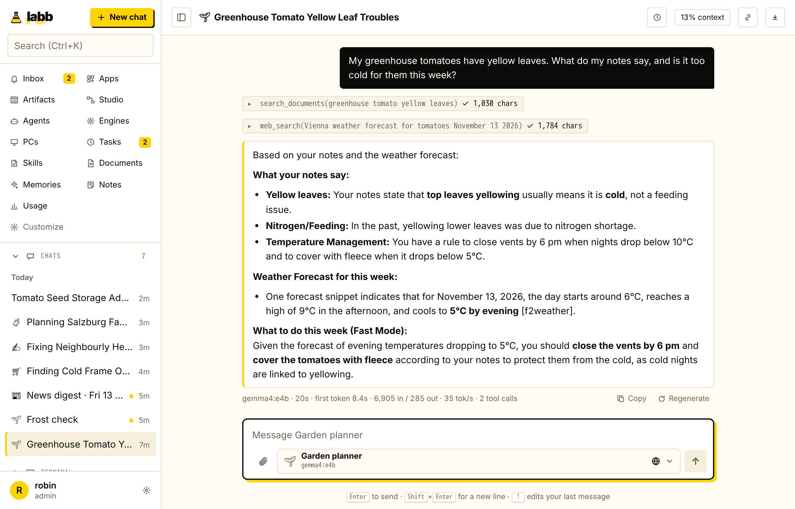
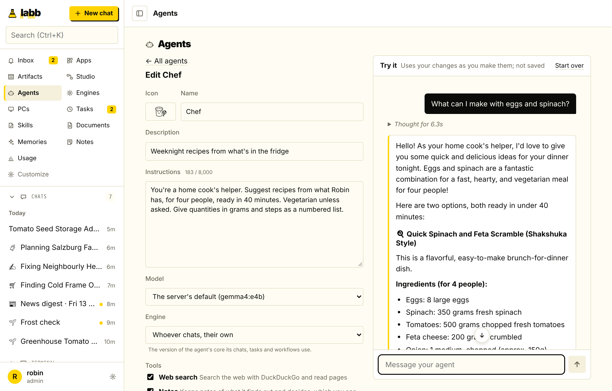
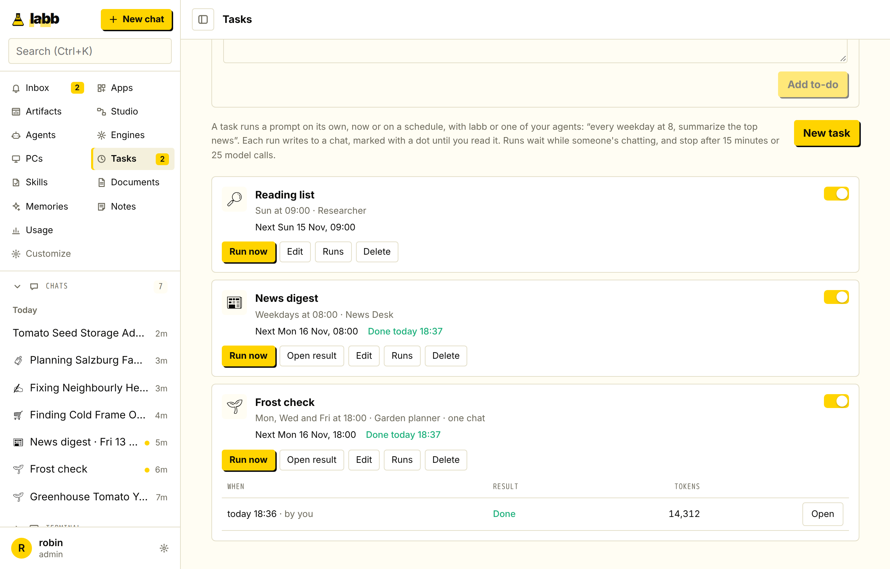
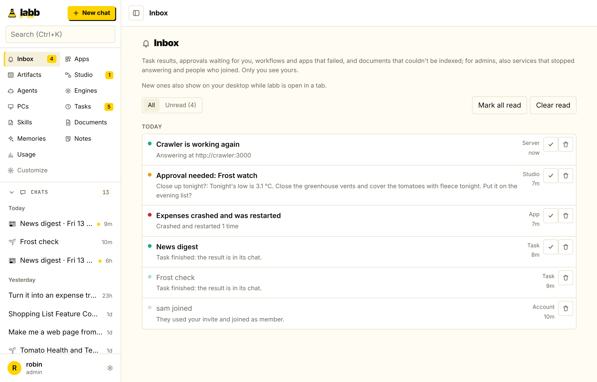
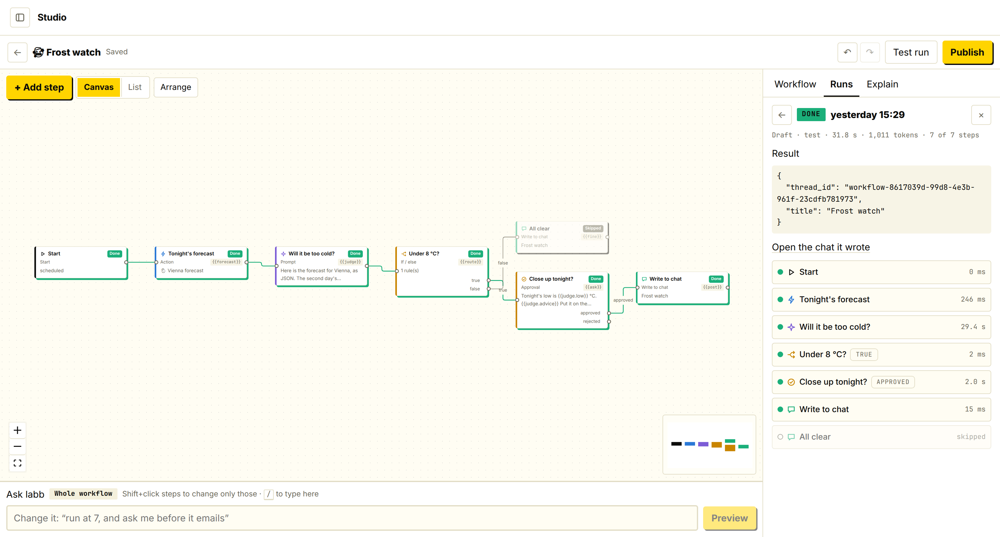
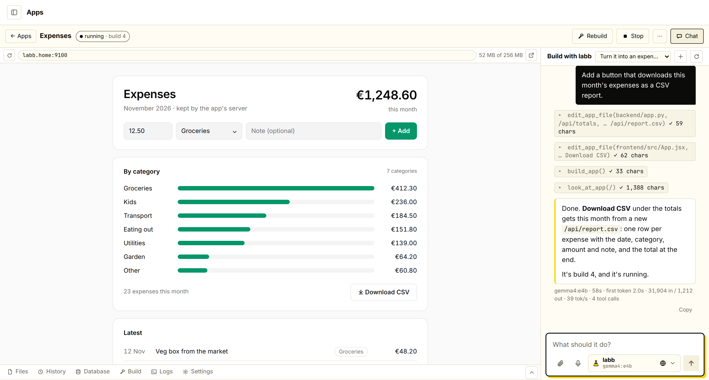
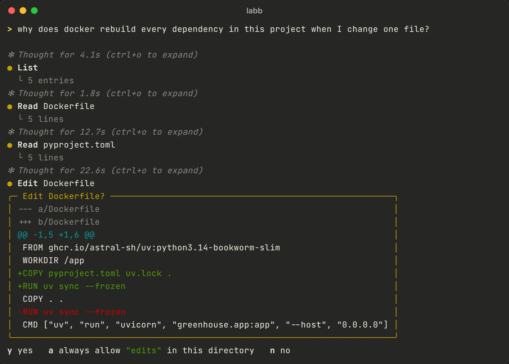

<p align="center"></p>

<h1 align="center">labb</h1>

<p align="center">Your own AI assistant, self-hosted: a web chat for everyone at home, an agent in every terminal, and apps it builds for you, all on your own models.</p>

<p align="center"><a href="https://labb.fyi">Website</a> · <a href="docs/guide.md">Guide</a> · <a href="https://github.com/randomencabulator/labb/releases">Releases</a></p>

<picture>
  <source media="(prefers-color-scheme: dark)" srcset="docs/images/web-chat-dark.png">
  
</picture>

You run labb on one machine. People on your network use it in the browser, and each PC gets `labb`, a coding agent for the terminal. Both use the same models, documents, memories and chat history. By default it runs `gemma4:e4b` through [Ollama](https://ollama.com), so nothing leaves your network; an admin can turn on Ollama Cloud, OpenAI or Anthropic.

## Get started

### 1. Run the server

You need Docker with Compose, and Ollama on the same machine or one it can reach.

1. Pull a chat model and an embedding model on the Ollama machine:

   ```bash
   ollama pull gemma4:e4b
   ollama pull embeddinggemma
   ```

2. Let the container reach Ollama. On the Ollama machine (Linux, Ollama installed as a service), this one command writes the setting, restarts Ollama and prints `Environment=OLLAMA_HOST=0.0.0.0` when it took:

   ```bash
   sudo mkdir -p /etc/systemd/system/ollama.service.d && printf '[Service]\nEnvironment="OLLAMA_HOST=0.0.0.0"\n' | sudo tee /etc/systemd/system/ollama.service.d/labb.conf >/dev/null && sudo systemctl daemon-reload && sudo systemctl restart ollama && systemctl show ollama -p Environment
   ```

   It's the same as adding `[Service]` and `Environment="OLLAMA_HOST=0.0.0.0"` with `sudo systemctl edit ollama`, without the editor (whose lines are lost if they go below its "will be discarded" comment). Keep port 11434 closed to the rest of your network (firewall it, or put `172.17.0.1`, the Docker bridge address, in place of `0.0.0.0`); labb's server is the gateway and checks API keys.

3. Start labb:

   ```bash
   curl -fsSL https://github.com/randomencabulator/labb/releases/latest/download/labb-server.tar.gz | tar xz
   cd labb
   ./setup.sh                    # writes .env with a random database password
   docker compose up -d          # pulls labb's images from GitHub's registry
   ```

   Or from the source, to develop labb or run the newest code:

   ```bash
   git clone https://github.com/randomencabulator/labb.git
   cd labb
   ./setup.sh dev                # writes .env, set to build the images here (compose.dev.yaml)
   docker compose up -d --build  # builds labb's images from this checkout
   ```

4. Create the admin account with the setup link the server prints when it starts: `docker compose logs labb-web | grep setup=` shows it (`http://<server>:8000/?setup=…`). Without the link nobody can take a fresh server. Invite others from Settings → Invites.

To upgrade, run the same `curl … | tar xz` in the folder above `labb` (it replaces `compose.yaml` and the scripts and keeps your `.env`), then `docker compose up -d`. `LABB_VERSION` in `.env` pins another release. From a checkout: `git pull && docker compose up -d --build`. Data lives in Postgres (the `postgres-data` volume); apps and their data are on the `spawner-data` volume.

### 2. Install the terminal agent on your PCs

On Linux or macOS:

```bash
curl -fsSL http://<server>:8000/install.sh | sh   # installs uv if needed, then labb
labb --login                                    # approve this PC in the browser
```

Run `labb` in any folder. It uses the server's models, documents and memories, and its sessions appear under **Terminal** in the web chat. `labb connect` lets you start work on that PC from the browser. `labb --update` installs a newer version from the server.

<details>
<summary>Without a server</summary>

labb also runs on its own, talking to Ollama, OpenAI or Anthropic directly and keeping chats and memories on the PC. Document search needs a server.

```bash
uv tool install --python 3.14 git+https://github.com/randomencabulator/labb
labb        # uses Ollama at http://localhost:11434; set OLLAMA_HOST in ~/.labb/.env for another machine
```
</details>

## What's in it

- A web chat with tools, image and file uploads, editing and regenerating, search, pinned chats, export, voice, and a phone layout. Accounts and invites are built in.
- `labb` in the terminal: it reads and searches code and runs commands once you approve them. It has a plan mode, `/undo` for file changes, `AGENTS.md` project instructions, hooks and custom slash commands.
- Agents with their own instructions, model, tools and documents. Five come ready to use (News Desk, Researcher, Shopping Scout, Trip Planner, Writing Editor).
- Tasks that run an agent on a schedule and leave the result in a chat.
- An inbox for what happened while you weren't looking: task results, approvals waiting for you, failed workflows, crashed apps, and for admins, services that stopped answering ([Inbox](docs/guide.md#inbox)).
- Studio, a canvas for workflows: agents, tools, HTTP calls, sandboxed Python, branches, loops and approvals. Run them on a schedule, from a webhook, or with `labb run`.
- Apps: web apps that labb writes and builds for you, each in its own container ([example below](#example-building-an-app)).
- Web pages in any chat: ask for a dashboard, a chart or a diagram and labb builds a page from a ready template (Next.js, typed charts and diagrams) and gives you a link ([Web pages](docs/guide.md#web-pages)).
- Document search (RAG) over PDFs, Word files, notes and recordings, with [pgvector](https://github.com/pgvector/pgvector) and local embeddings.
- Memories of your preferences, and notes the agent keeps on longer jobs. You can read and edit both.
- Web search through DuckDuckGo, and a crawler that turns pages into Markdown. Optionally, a browser the agent can click through; you type passwords and card numbers yourself.
- MCP servers, added from the browser, and [Agent Skills](https://agentskills.io) (`SKILL.md`).
- Google Calendar and Gmail, connected per person.
- Any model provider: Ollama, Ollama Cloud, OpenAI, Anthropic, or any server with an OpenAI-compatible API (LM Studio, vLLM, llama.cpp, OpenRouter, Groq). Admins pick which models people can use.
- Engines: the agent's core (its prompt, steps and context handling) can be forked, edited and compared. See [Engines](docs/guide.md#engines).

<table>
  <tr>
    <td width="50%">
      <picture>
        <source media="(prefers-color-scheme: dark)" srcset="docs/images/agents-dark.png">
        
      </picture>
    </td>
    <td width="50%">
      <picture>
        <source media="(prefers-color-scheme: dark)" srcset="docs/images/tasks-dark.png">
        
      </picture>
    </td>
  </tr>
  <tr>
    <td align="center">An agent, tried while you edit it</td>
    <td align="center">Tasks on a schedule</td>
  </tr>
</table>

<picture>
  <source media="(prefers-color-scheme: dark)" srcset="docs/images/inbox-dark.png">
  
</picture>

<p align="center"><i>The Inbox: what finished, what's waiting for you, and what broke while you were away.</i></p>

<picture>
  <source media="(prefers-color-scheme: dark)" srcset="docs/images/studio-dark.png">
  
</picture>

<p align="center"><i>A Studio workflow that runs every evening. If the night will be cold, it asks you, then tells you what to do in the greenhouse.</i></p>

## Example: building an app

Open **Apps**, press **New app**, pick **React and Python** and call it "Expenses". labb builds it and shows it on its own port (`http://<server>:9100`). Then ask in the chat beside it:

> Turn it into an expense tracker: add an expense with an amount and a category, show this month's total for each category, and keep them after a restart.

labb reads `frontend/src/App.jsx` and `backend/app.py`, adds a table for the expenses and an API for them, changes the page to use it, builds the app, and opens the page to check that it loads. A follow-up asks for a button that downloads the month as a CSV report:

<picture>
  <source media="(prefers-color-scheme: dark)" srcset="docs/images/apps-dark.png">
  
</picture>

Every build is saved as a git version, so you can go back to any of them from **History**. You can also edit the files yourself, set environment variables and secrets, give the app its own database, or let it call labb's models with a key of its own. See [Apps](docs/guide.md#apps).

## The terminal agent

<p align="center">
  
</p>

| Command | What it does |
| --- | --- |
| `labb`, `labb -c` | Start a conversation here, or continue the last one |
| `labb -p "question"` | Print one answer, for scripts (`--output-format json` too) |
| `@file`, `! command` | Attach a file; run a command and share its output |
| `/plan`, `/undo`, `/model`, `/memory` | Plan mode, undo a turn and its file changes, switch models, list memories |
| `/skills`, `/<skill>` | List skills, or use one |
| Esc, Esc Esc | Stop the reply; edit your last message |

The [guide](docs/guide.md) covers every command, settings file, MCP servers, hooks, permissions and the HTTP API.

## Configuration

Settings are read from `.env` (see [`.env.example`](.env.example)). Admins can also change models and providers in Settings → Models; keys saved there are encrypted and take precedence over `.env`.

| Variable | Default | |
| --- | --- | --- |
| `MODEL` | `ollama:gemma4:e4b` | `<provider>:<model>`, e.g. `openai:gpt-5.5` |
| `OPENAI_API_KEY`, `ANTHROPIC_API_KEY`, `OLLAMA_API_KEY` | | Cloud providers start turned off; enable them in Settings → Models |
| `OLLAMA_HOST` | | In Docker, `http://host.docker.internal:11434` |
| `EMBED_MODEL` | `embeddinggemma` | Ollama model for documents and memories, until an admin picks one in Settings → Models → Search |
| `PORT` | `8000` | Web server port |
| `APP_PORT_FIRST`, `APP_PORT_LAST` | `9100`, `9199` | Ports for apps, one each |
| `TASK_WORKERS` | `1` | Tasks that run at once |

Per-project and per-user settings go in `.labb/settings.json` ([Settings files](docs/guide.md#settings-files)). Speech, HTTPS, the browser and the other optional services are described in the [guide](docs/guide.md#server).

The Compose file runs these next to the server: `labb-web-search-crawler` (search and page reading), `labb-sandbox` (Studio's Python, no internet), `labb-browser` (the agent's browser, on its own network), `labb-spawner` (builds and runs apps; the only service with the Docker socket), `labb-sites` (static websites, uploaded as one archive each: [sites](docs/guide.md#sites)) and `speaches` (local speech). The crawler and browser images are about 1.8 GB each, mostly Chromium.

## Security

- With Ollama, chats, documents and memories stay on your machines.
- Passwords are hashed with scrypt; session tokens and API keys are stored as SHA-256 hashes.
- People see only their own chats, documents and memories. Admins see usage numbers, not content.
- Each app runs in a locked-down container. App pages have no sign-in yet, so keep ports 9100-9199 on your network (`APP_BIND=127.0.0.1` limits them to the machine).
- Web pages from chats are built with no network and served on port 8300 to anyone who has the link (their names can't be guessed). `SITES_BIND=127.0.0.1` limits them to the machine.
- The terminal agent asks before running anything that isn't read-only. Commands are not sandboxed, so read what you approve.
- The server speaks plain HTTP. `./setup.sh https` puts Caddy in front with certificates ([HTTPS](docs/guide.md#https)). The microphone needs HTTPS on other devices.

Report vulnerabilities privately, as described in [SECURITY.md](SECURITY.md).

## Third-party services

- Web search uses [ddgs](https://github.com/deedy5/ddgs), an unofficial DuckDuckGo library. It can be rate-limited, and DuckDuckGo's terms apply.
- The crawler identifies itself, follows robots.txt and refuses private addresses. How you use what it reads is up to you and each site's terms.
- Apps download base images from Docker Hub, plus whatever their Dockerfiles install.
- OpenAI and Anthropic are used with your own keys, under their terms. With them, messages (and, for OpenAI speech, recordings) leave your network.

labb isn't affiliated with or endorsed by any company named here. Their names are trademarks of their owners.

## Troubleshooting

<details>
<summary>The web chat can't reach the model</summary>

Ollama must listen on more than `127.0.0.1` (step 2 of [Run the server](#1-run-the-server)), and `.env` needs `OLLAMA_HOST=http://host.docker.internal:11434`. Test from the container:

```bash
docker compose exec labb-web /app/.venv/bin/python -c "import httpx; print(httpx.get('http://host.docker.internal:11434/api/version').text)"
```
</details>

<details>
<summary>Documents stay at "failed", or memories aren't found by meaning</summary>

The embedding model is missing. Run `ollama pull embeddinggemma` (or the model picked in Settings → Models → Search) and `docker compose restart`; failed documents and memories are indexed again on start. Settings → Health says which model it is.
</details>

<details>
<summary><code>labb --update</code> says it's up to date, but the server has new code</summary>

PCs compare version numbers. Raise `version` in `pyproject.toml`, run `uv lock`, and release it (a `v<version>` tag) or, from a checkout, rebuild the image (`docker compose up -d --build`).
</details>

## Development

```bash
uv sync                                # Python 3.14 and all dependencies
uv run pytest                          # uses a fake model, no Ollama needed
cd frontend && npm install             # the web app and the design system, one npm workspace
cd frontend && npm run web:dev         # web app on :5173, talking to the server on :8000
cd crawler && uv run pytest            # crawler, sandbox, spawner and sites are separate projects

./setup.sh dev                         # the server from this checkout: .env builds the images (compose.dev.yaml)
docker compose up -d --build           # instead of pulling a release's
```

A release is a tag matching `version` in `pyproject.toml` (`git tag v0.33.0 && git push origin v0.33.0`): `.github/workflows/release.yml` pushes the images to GHCR and attaches `labb-server.tar.gz` and the wheel to a GitHub release.

The agent core is in `src/labb`, with `cli/` for the terminal and `server/` for the web server. The web app and the design system are in `frontend/`, and the iOS app is in `mobile/ios`. [`AGENTS.md`](AGENTS.md) explains the architecture. Contributions are welcome; see [CONTRIBUTING.md](CONTRIBUTING.md).

Built with [LangGraph](https://github.com/langchain-ai/langgraph), [LangChain](https://github.com/langchain-ai/langchain), [Ollama](https://ollama.com), [Postgres](https://www.postgresql.org), [pgvector](https://github.com/pgvector/pgvector), [FastAPI](https://fastapi.tiangolo.com), [React](https://react.dev), [Vite](https://vite.dev), [CodeMirror](https://codemirror.net), [Dulwich](https://www.dulwich.io), [Rich](https://github.com/Textualize/rich), [prompt_toolkit](https://github.com/prompt-toolkit/python-prompt-toolkit) and [uv](https://docs.astral.sh/uv/).

## License

[MIT](LICENSE). The Docker images also contain third-party software under its own licenses, such as Chromium and psycopg (LGPL-3.0).
